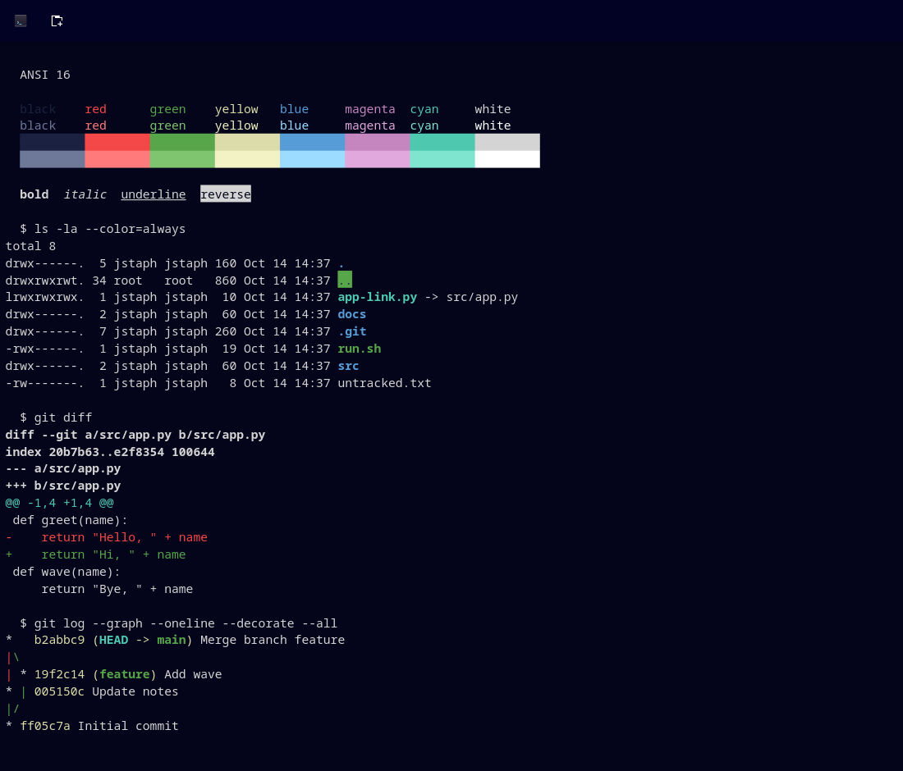

# Deepwick for Ptyxis

A deep navy terminal palette with Visual Studio 2022's syntax colors.

> Deepwick is an unofficial theme derived from
> [Polywick Blue](https://vscode.polywickstudio.net) by Polywick Studio (MIT).
> Not affiliated with Polywick Studio.



## Install

```sh
mkdir -p "${XDG_DATA_HOME:-$HOME/.local/share}/org.gnome.Ptyxis/palettes"
cp deepwick.palette "${XDG_DATA_HOME:-$HOME/.local/share}/org.gnome.Ptyxis/palettes/"
```

Or run `ptyxis --import-palette deepwick.palette`.

## Activate

Open **Preferences → Appearance → Palette** and choose **Deepwick**, or set it
for your default profile from a shell:

```sh
gsettings set "org.gnome.Ptyxis.Profile:/org/gnome/Ptyxis/Profiles/$(gsettings get org.gnome.Ptyxis default-profile-uuid | tr -d "'")/" palette 'deepwick'
```

## Notes

- The superuser header bar (shown for `sudo`/`su` tabs) uses Red; the remote
  header bar (SSH) uses Magenta. Both use Background for text.
- Ptyxis does not support a custom selection color, so selection follows
  Ptyxis's default.

Tested with Ptyxis 50.1.

## License

MIT. See [LICENSE](LICENSE).
